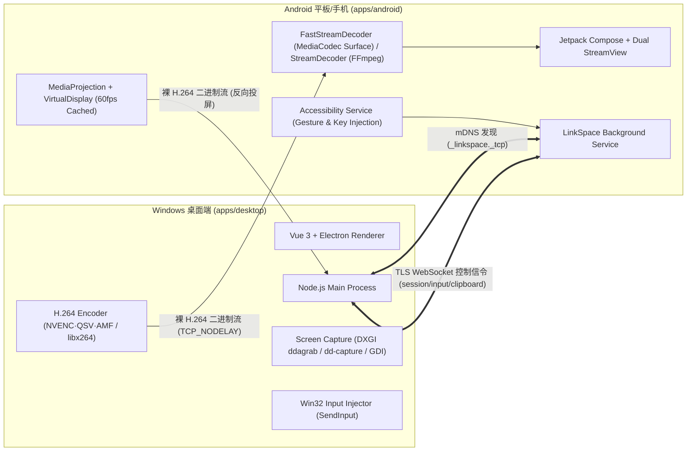

# LinkSpace

<div align="center">

**让电脑、手机和平板像同一个工作空间中的不同终端一样无缝协作。**

[English](README_EN.md) | [简体中文](README.md)

[](apps/desktop)
[](apps/android)
[]()
[]()
[](LICENSE)

</div>

---

## 📖 项目简介

**LinkSpace** 是一款专注于**纯局域网（LAN-First）**的多设备协作工具。它打破了 Windows 电脑与 Android 平板/手机之间的壁垒，无需依赖任何云端中继或第三方账号体系，所有流量与隐私数据**严格不出局域网**。

在 LinkSpace 中，任一设备都可以成为主控端或被控端，实现真正的**对称互控、超低延迟投屏操作、高速文件互传与跨端剪贴板共享**。

---

## ✨ 核心特性

### 🖥️ 1. 双向跨端对称互控（Symmetric Cross-Device Control）
- **电脑控制平板**：
  - 电脑窗口内实时查看平板高帧率画面；
  - 鼠标单击、长按拖拽、滚轮滚动直通平板无障碍手势；
  - 物理键盘与中文拼音直通，支持剪贴板文字直接上屏；
  - 鼠标右键一键返回系统桌面、中键一键返回主页。
- **平板控制电脑**：
  - 平板全屏高清映射电脑桌面（支持点哪指哪与相对触控板两种模式）；
  - 支持虚拟多按键、自绘键盘与滚轮手势；
  - 多屏环境下支持一键切换要投屏与控制的显示器。

### 🚀 2. 双擎自适应毫秒级超低延迟串流（Dual-Engine Ultra-Low Latency Streaming）
- **高性能硬编硬解管线（Fast Mode，默认优先）**：
  - **桌面端 DXGI 零拷贝抓屏 + GPU 硬件编码**：采用 `ddagrab`（DXGI Desktop Duplication）抓屏与 GPU 硬件缩放，自动探测并启用 `h264_nvenc` / `h264_qsv` / `h264_amf` 硬件编码器，按完整 H.264 访问单元（AU）带时间戳封包直发；
  - **Android 端 `MediaCodec` `Surface` 硬解直投**：零 CPU 像素拷贝直接解码至 GPU 纹理渲染，支持 Android 11+ 标准低延迟与高通/联发科/麒麟底层低延迟硬件扩展，内置 2.5s 首帧看门狗，异常时无缝自动回退兼容模式。
- **高兼容软编软解管线（Compat Mode，自动兜底）**：
  - **桌面端**：`gdigrab` + `libx264` 多线程切片并行编码（`sliced-threads=1`、CRF 恒定画质 + VBV 窄缓冲封顶），全链路开启 `TCP_NODELAY`；
  - **Android 端**：基于 FFmpeg `libavcodec` 4 线程切片软解 + `libswscale` NEON 加速 `YUV420P -> RGBA` 转换，配合 120Hz 触控合并与本地即时光标绘制。

### 🛡️ 3. 双向免确认有效期与长效保活（Smart Authorization & Zero-Dialog）
- **多天免确认授权**：
  - 电脑与平板双向支持选择免确认有效期：`仅本次` / `1天` / `3天` / `7天` / `30天` / `永久`；
  - 有效期内再次发起控制或投屏无需重复点击弹窗确认，随时可在设备详情或设置中调整或一键撤销。
- **长效录屏复用**：
  - 平板端推流停止后仅断开 Surface 连接，保持系统 `MediaProjection` 与 `VirtualDisplay` 句柄跨会话存活；
  - 免确认期内电脑重连投屏实现**零 LinkSpace 弹窗、零系统录屏弹窗**秒级秒开。

### 🔓 4. 锁屏直接唤醒与密码/图案盲输辅助（Lock Screen Wake & Blind Unlock Helper）
- **平板端息屏唤醒与上滑解锁**：
  - 当电脑发起控制或投屏时，平板端自动通过 `WakeLock` 与 `requestDismissKeyguard` 点亮屏幕，并自动注入平滑上滑解锁手势；
  - 电脑端反向投屏窗口顶栏常驻「亮屏解锁」与「锁屏辅助」按钮，针对 Android 锁屏密码页系统级黑屏保护（`FLAG_SECURE`），内置自适应横竖屏的**数字 PIN 键盘**与**九宫格图案连线面板**，支持远程盲输密码解锁。
- **电脑端显示器唤醒**：
  - 平板发起控制被授权时，电脑端自动调用 Win32 原生电源接口唤醒休眠息屏的显示器。

### 📁 5. 局域网高速文件分块直传（High-Speed File Transfer）
- 支持大文件并发分块传输、断点续传与全局 SHA-256 完整性强校验；
- 接收端同名防覆盖安全重命名，传输进度实时双向回填。

### 📋 6. 双向无感剪贴板同步（Clipboard Sync）
- 电脑与平板后台文本剪贴板自动同步；
- 内置 500ms 来源回环抑制（Echo Suppression），避免跨端死循环粘贴；
- 默认严格安全模式（按需手动开启）。

---

## 🏗️ 系统架构

LinkSpace 采用基于 TLS 的全双工通信管道，控制信令与视频二进制帧在同一通道内按协议分流：



---

## 🛠️ 技术栈

| 模块 | 技术实现 | 说明 |
|---|---|---|
| **桌面端核心** | Electron 37 + TypeScript | 跨平台桌面壳体、主/渲染进程架构 |
| **桌面端 UI** | Vue 3 + TailwindCSS | 现代化响应式控制台、设备卡片与全屏投屏视窗 |
| **桌面端原生接入** | Koffi (Win32 FFI) | 鼠标键盘原生注入 (`SendInput`)、显示器唤醒与光标追踪 |
| **Android 客户端** | Kotlin 2.0 + Jetpack Compose | 现代化声明式界面、Material 3 设计 |
| **Android 输入注入** | Android Accessibility Service | 系统级触摸手势、返回/主页动作、锁屏唤醒上滑解锁 |
| **Android 视频解码** | `MediaCodec` Surface 硬解 + Bytedeco FFmpeg (`libavcodec` + `libswscale`) | 双擎解码：优先 GPU Surface 零拷贝硬解，异常自动无缝回退多线程 NEON 软解 |
| **网络通信** | mDNS + TLS 1.3 + WebSocket | 局域网服务自发现、安全握手与二进制流分发 |

---

## 🚀 快速上手

### 1. Windows 桌面端
- **安装运行**：
  直接下载并安装打包产物：`LinkSpace Setup 0.1.0.exe`，启动后软件将自动监听局域网并在后台就绪。
- **源码运行**：
  ```bash
  cd apps/desktop
  npm install --ignore-scripts
  # 下载 Electron 运行环境
  npm run dev
  ```

### 2. Android 平板 / 手机端
- **安装**：
  安装 `app-debug.apk` 到设备。
- **权限引导**：
  1. 开启 **「LinkSpace 远程输入」** 无障碍服务（被控时注入触摸操作、锁屏上滑解锁必须）；
  2. 授予通知与前台服务权限（保证息屏/后台连接不断连）；
  3. 首次投屏或控制弹窗选择所需的免确认有效期（例如 `7天` 或 `永久`）。

### 3. 连接与使用
1. 确保电脑与平板处于**同一 Wi-Fi 或局域网**；
2. 双方设备将通过 mDNS **自动发现**彼此，点击对方卡片输入 6 位配对码完成一次性配对；
3. 配对后即可直接使用：**电脑控制平板**、**平板控制电脑**、**文件互传** 或 **剪贴板同步**。

---

## 🔒 安全与隐私设计

1. **绝对私有（Zero Cloud）**：没有中央服务器，不上传任何遥测、设备信息或文件到外网。
2. **端到端安全传输**：所有局域网流量强制走 TLS 加密传输，首次配对采用 TOFU（Trust On First Use）证书指纹比对。
3. **输入授权边界**：控制权限与配对关系独立解耦；任何控制会话均需明确授权（或在用户设定的免确认有效期内），用户可随时一键终止。

---

## 📚 详细技术文档

- [系统架构设计 (Architecture)](docs/architecture.md)
- [网络通信协议规范 (Protocol)](docs/protocol.md)
- [安全与威胁模型 (Threat Model)](docs/threat-model.md)
- [开源依赖许可证清单 (Licenses)](docs/license-inventory.md)
- [演进路线图 (Roadmap)](docs/roadmap.md)

---

## 📄 开源许可证

本项目基于 [Apache License 2.0](LICENSE) 开源许可证分发与使用。第三方依赖合规清单请参阅 [Third-Party Licenses](docs/license-inventory.md)。
