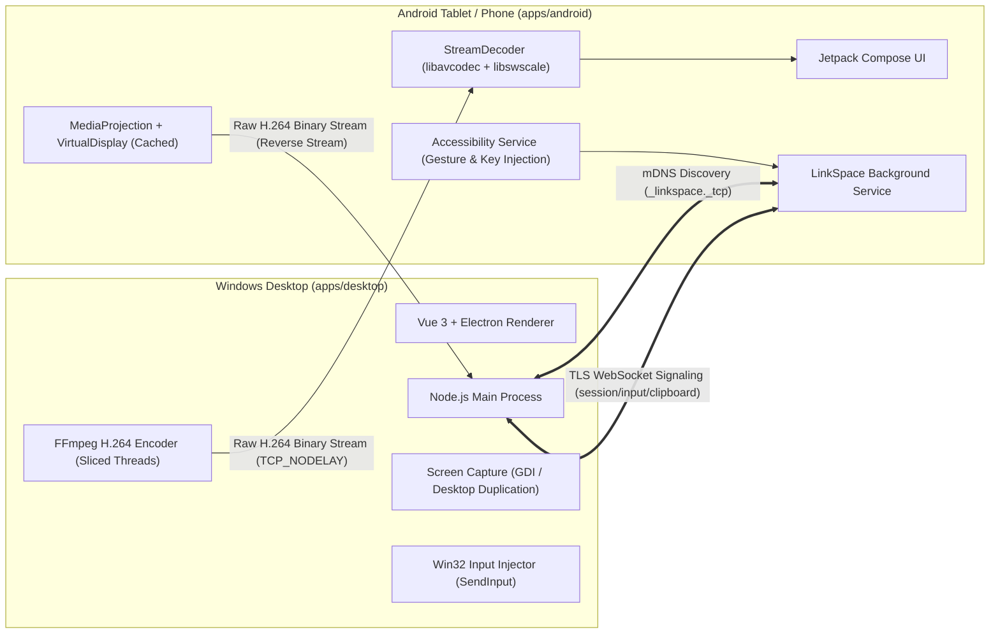

# LinkSpace

<div align="center">

**Empowering PCs, tablets, and phones to collaborate seamlessly as unified endpoints in a single workspace.**

[English](README_EN.md) | [简体中文](README.md)

[](apps/desktop)
[](apps/android)
[]()
[]()
[](LICENSE)

</div>

---

## 📖 Introduction

**LinkSpace** is a **pure local network (LAN-First)** multi-device collaboration tool. It bridges the gap between Windows PCs and Android tablets/phones without depending on any external cloud relay, proprietary account system, or telemetry. All user data, screen streams, and control inputs **strictly never leave your local area network**.

In LinkSpace, any device can act as both controller and controlled client, enabling true **symmetric cross-device control, ultra-low latency screen mirroring, high-speed file transfers, and seamless clipboard synchronization**.

---

## ✨ Key Features

### 🖥️ 1. Symmetric Cross-Device Control
- **PC Controls Tablet**:
  - View real-time high-FPS tablet screens within a responsive PC desktop window.
  - Mouse clicks, long-press drags, and wheel scrolls map directly to native Android accessibility gestures.
  - Hardware keyboard pass-through with Pinyin IME composition and clipboard text entry.
  - Mouse right-click maps to Android Back, and middle-click maps to Home.
- **Tablet Controls PC**:
  - Full-screen high-definition PC desktop streaming with both direct-touch ("touch where you see") and relative touchpad modes.
  - On-screen touch keys, virtual software keyboard, and two-finger scroll gestures.
  - Multi-monitor picker allows switching between different PC displays in one click.

### 🚀 2. Dual-Engine Ultra-Low Latency Streaming (60+ FPS)
- **High-Performance Hardware Pipeline (Fast Mode, Default)**:
  - **Desktop DXGI Zero-Copy Capture + GPU Encoding**: Captures frames via `ddagrab` (DXGI Desktop Duplication) with GPU scaling and auto-probed `h264_nvenc` / `h264_qsv` / `h264_amf` hardware encoders, delivering framing per H.264 Access Unit (AU).
  - **Android `MediaCodec` `Surface` Hardware Decoding**: Zero-CPU-copy direct decoding onto GPU `TextureView` surfaces with Android 11+ and vendor low-latency extensions, guarded by a 2.5s first-frame watchdog that seamlessly falls back to Compatibility Mode if needed.
- **Compatibility Software Pipeline (Compat Mode, Automatic Fallback)**:
  - **Desktop**: `gdigrab` + `libx264` multi-threaded sliced encoding (`sliced-threads=1`, capped CRF + tight VBV buffer) with end-to-end `TCP_NODELAY`.
  - **Android**: Multi-threaded slice decoding (`FF_THREAD_SLICE`) via FFmpeg `libavcodec` + NEON `libswscale` `YUV420P -> RGBA` rendering, paired with 120Hz touch coalescing and instant local cursor overlay.

### 🛡️ 3. Multi-Day No-Confirm Trust & Persistent Projection
- **Customizable Trust Durations**:
  - Both PC and Android clients support user-selectable trust durations: `This session only`, `1 Day`, `3 Days`, `7 Days`, `30 Days`, and `Permanent`.
  - Re-connections within the validity window bypass confirmation prompts completely. Durations can be adjusted or revoked at any time.
- **Persistent MediaProjection**:
  - When stopping a reverse stream, LinkSpace detaches the encoder surface while caching the `MediaProjection` and `VirtualDisplay` handles.
  - Re-streaming from PC within the validity period launches instantly with **zero LinkSpace prompts and zero Android system projection dialogs**.

### 🔓 4. Lock Screen Wake & Blind PIN/Pattern Unlock Helper
- **Tablet Wake & Unlock**:
  - When PC initiates control or streaming, Android's accessibility service acquires a `WakeLock`, invokes `requestDismissKeyguard`, and dispatches an automated swipe-up unlock gesture.
  - Built-in **"Wake & Unlock"** and **"Unlock Helper"** tools in the PC viewer title bar provide an orientation-adaptive **PIN Pad** and **9-Dot Pattern Grid** to remotely unlock tablets even when Android's `FLAG_SECURE` masks the lock screen in black.
- **PC Display Wakeup**:
  - When tablet controls the PC, LinkSpace automatically wakes sleeping PC monitors via native Win32 power execution state APIs.

### 📁 5. High-Speed LAN File Transfer
- Concurrent chunked file streaming with resume support and SHA-256 integrity verification.
- Safe auto-renaming prevents accidental overwrites on the receiver.

### 📋 6. Bidirectional Clipboard Synchronization
- Background text clipboard sync between PC and tablet.
- 500ms echo suppression loop prevention to eliminate recursive cross-device pastes.

---

## 🏗️ System Architecture

LinkSpace uses a TLS-encrypted full-duplex socket channel where JSON control messages and raw binary H.264 video frames are multiplexed:



---

## 🛠️ Tech Stack

| Module | Technologies | Description |
|---|---|---|
| **Desktop Core** | Electron 37 + TypeScript | Main / Renderer multi-process architecture |
| **Desktop UI** | Vue 3 + TailwindCSS | Responsive dashboard, device cards, full-screen canvas |
| **Native Integration** | Koffi (Win32 FFI) | Native input injection (`SendInput`), display wake, cursor tracker |
| **Android Client** | Kotlin 2.0 + Jetpack Compose | Declarative UI with Material 3 components |
| **Android Input** | Android Accessibility Service | System touch gestures, navigation actions, lock screen swipe unlock |
| **Android Decoder** | `MediaCodec` Surface + Bytedeco FFmpeg (`libavcodec` + `libswscale`) | Dual-engine: zero-copy GPU Surface hardware decode with automatic fallback to NEON software decode |
| **Networking** | mDNS + TLS 1.3 + WebSocket | Zero-config service discovery, mutual authentication, binary streaming |

---

## 🚀 Quick Start

### 1. Windows Desktop
- **Installer**:
  Download and run `LinkSpace Setup 0.1.0.exe`.
- **Run from Source**:
  ```bash
  cd apps/desktop
  npm install --ignore-scripts
  npm run dev
  ```

### 2. Android Client
- **Install**:
  Install `app-debug.apk` onto your tablet or phone.
- **Permissions**:
  1. Enable **LinkSpace Remote Input** Accessibility Service (required for touch input injection & lock screen unlock).
  2. Grant notification and foreground service permissions.
  3. When pairing or starting a stream, select your desired no-confirm duration (e.g., `7 Days` or `Permanent`).

### 3. Pairing & Connection
1. Connect both PC and Android devices to the **same Wi-Fi or local area network**.
2. Both devices will automatically detect each other via mDNS. Click on a device card and enter the 6-digit verification code to pair.
3. Enjoy bidirectional remote control, ultra-low latency streaming, file transfers, and clipboard syncing.

---

## 🔒 Security & Privacy

1. **Zero Cloud**: No centralized servers. Zero tracking or telemetry. Data strictly stays on your local network.
2. **End-to-End Encryption**: All traffic is encrypted over TLS with TOFU (Trust On First Use) certificate fingerprint verification.
3. **Strict Input Boundaries**: Input control requires explicit consent and can be revoked at any moment.

---

## 📚 Documentation

- [System Architecture](docs/architecture.md)
- [Communication Protocol](docs/protocol.md)
- [Threat Model & Security](docs/threat-model.md)
- [Third-Party Licenses](docs/license-inventory.md)
- [Project Roadmap](docs/roadmap.md)

---

## 📄 License

This project is licensed under the [Apache License 2.0](LICENSE).
